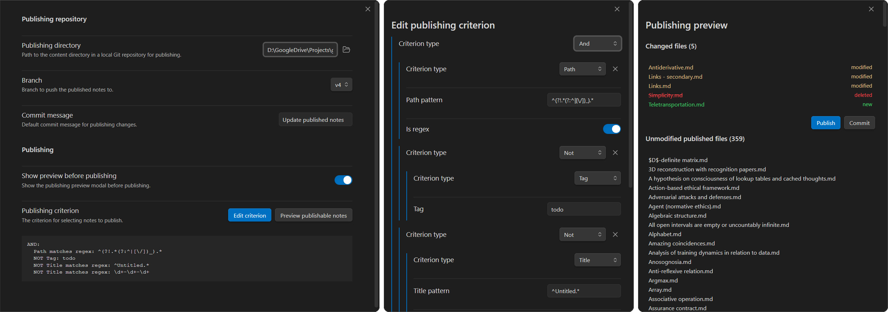

# Selective Publisher for Obsidian

A plugin for Obsidian that selectively publishes notes to a Git repository based on customizable criteria.

## Features


- Filtering of notes and attachments based on tags, frontmatter, path, or content, and path-based filtering of other files.
- Committing and pushing to a target Git repository.
- Review of changes with diffs before publishing.

## Requirements

- Obsidian v1.13.0+
- Git installed and configured locally.
- A local clone of target remote repository. 
- For publishing as a website, the repository should typically contain a static site generator which is able to process Obsidian Markdown files, such as [Quartz](https://github.com/jackyzha0/quartz).

## Installation

1. Search for [Selective Publisher](https://community.obsidian.md/plugins/selective-publisher) in Obsidian's Community Plugins.
2. Click "Install" and then "Enable".

## Setup

1. Clone your target repository (e.g., GitHub Pages) to a local folder.
2. In the plugin settings:
   - Set "Publishing directory" to the absolute local path of the repository or a directory within it. (If Quartz is used, this is the `content` directory.)
   - Optionally, change the "Branch" (e.g., `main`).
   - Configure "Publishing criterion" (see below).
   - Optionally, uncheck "Show preview before publishing" to skip the preview modal when publishing.

## Usage

### Publishing criterion

The plugin evaluates each markdown file against a tree combining criteria:
- **Tag**: Matches an Obsidian tag exactly, by prefix, or by substring (e.g., `public` with "starts with" matches `#public/blog`).
- **Frontmatter**: Matches a YAML frontmatter key by existence, or its value by equality, substring, or regex.
- **Title**: Matches the file basename (without extension) by substring, regex, or glob.
- **Path**: Matches the path relative to the vault root by substring, regex, or glob.
- **Content**: Matches the file content with a regex.

Criteria can be combined with logical operators: **AND**, **OR**, and **NOT**.

### Publishing

Publish with the ribbon button (paper plane icon) or the **Publish notes** command. If the "Show preview before publishing" setting is enabled (the default), a preview opens first. The **Preview publishable files** command opens the same preview.

The preview lists the matching files with their status relative to the target repository (new, modified, deleted, unmodified), can show file diffs, and lets you publish (commit and push) or just commit (local only).

## Development

```bash
npm install        # install dependencies
npm run dev        # build in watch mode (for development)
npm run build      # type-check and build for production
npm run lint       # run ESLint
```

To test locally, put `main.js` and `manifest.json` into `<your-vault>/.obsidian/plugins/selective-publisher/` and reload the plugin.

## Other information

- [Disclosures](https://docs.obsidian.md/Developer+policies#Disclosures) per Obsidian developer policies:
    - Network use. The network is used for synchronizing with the remote Git repository when publishing. No data is sent to any other servers.
    - Accessing files outside of Obsidian vaults. The plugin manages the content directory in the local repository and the `git` command.
- AI agents used in development: Claude 3.7 Sonnet – Opus 4.6, GPT-4o – GPT-5.2, Gemini 3 Pro and Flash, Claude Opus 5.5

## Related projects

Obsidian plugins:
- [Enveloppe](https://github.com/Enveloppe/obsidian-enveloppe)
   - Publishes via the GitHub API rather than a local Git repository.
   - Has more features and options, including processing of links and dataviews.
   - Has less flexible filtering of files.
- [Quartz Syncer](https://github.com/saberzero1/quartz-syncer)
   - Publishes through authentication to different Git providers.
   - Has more features, including frontmatter processing and integration with other plugins such as Dataview.
   - Has less flexible filtering of files.
- [Digital Garden](https://github.com/oleeskild/obsidian-digital-garden)

Static site generators and other projects:
- [Quartz](https://github.com/jackyzha0/quartz)
- [Obsidian Publish](https://obsidian.md/publish)
